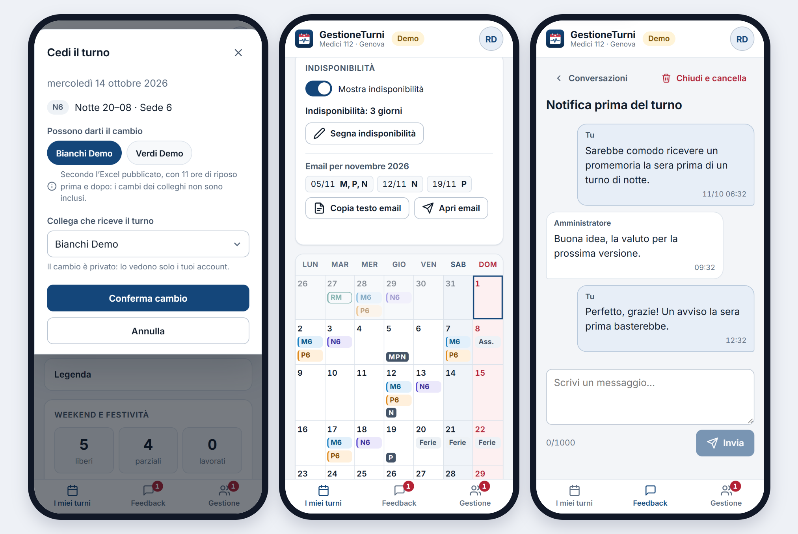
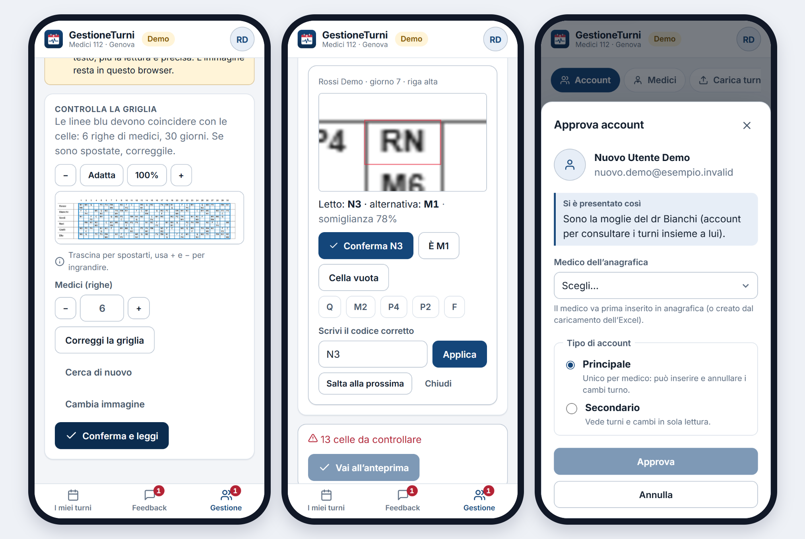

# 118Shifts

**Turni personali per i medici del 112 (ex 118) di Genova, sempre in tasca.**

118Shifts è una Progressive Web App *mobile first* che trasforma il file Excel ufficiale dei turni in un calendario personale chiaro e riservato. Ogni medico vede solo i propri turni, con sedi, festività, ore del mese, cambi e proiezione della turnazione.

> **Stato:** Fase 1 — prima versione pubblicata su Firebase Hosting, in prova. Il repository non contiene dati reali: i turni sono caricati dagli amministratori e restano su Firebase, protetti da regole di accesso.

> 📄 **Guida per i medici** (2 pagine, da stampare o condividere): [Guida-GestioneTurni.pdf](docs/Guida-GestioneTurni.pdf). Spiega con parole semplici come entrare (QR code verso la pagina pubblica), cosa fa l'app e, con la massima trasparenza, chi vede quali dati.

> 🗣️ **Siri e CarPlay** (iPhone): con un tocco su «Attiva Siri» nell'app, basta dire «Ehi Siri, Turni 118» e chiedere «Dove lavoro oggi?», «Sarò di turno il 30 maggio?», «Chi mi può dare il cambio il 20 maggio?» o «Chi lavora con me oggi?», anche in auto. Ogni medico riceve risposte solo sui propri turni. Dettagli in [docs/SIRI.md](docs/SIRI.md).

> 🎬 **Video di presentazione** (1 minuto, dati di esempio inventati): [guarda su YouTube](https://youtu.be/scJRPhcOiV4). È visibile anche nella pagina pubblica dell'app.

---

## L'app in breve

### A cosa serve
I turni dei medici del 112 di Genova sono decisi a monte e distribuiti come un unico grande file Excel, un foglio per mese, con tutti i medici e tutte le sedi. Per sapere quando e dove si lavora bisogna aprirlo, cercare la propria riga e interpretare i codici. Ricordarsi poi dei cambi concordati con i colleghi e fare i conti delle ore è un lavoro a parte.

118Shifts fa questo lavoro una volta per tutti. Ogni medico apre l'app dal telefono, come una normale applicazione installata sulla schermata Home, e trova **solo il proprio calendario**: turno di oggi e di domani, sede, orari, festività, weekend liberi, ore del mese e i cambi già applicati, con sotto un breve riepilogo a parole (colleghi del cambio, smonto dalla notte, messaggio gentile nei giorni di riposo, ferie o malattia). Niente fogli condivisi da scorrere, niente codici da decifrare.

### I turni si caricano una sola volta, per tutti
L'amministratore (o un delegato) carica il file Excel del mese, o in alternativa uno screenshot della tabella. L'app lo legge **nel browser**, riconosce i medici anche quando il nome è scritto in modi diversi, segnala i codici sconosciuti e mostra un'**anteprima** prima della pubblicazione. Dopo la conferma i turni compaiono subito nel calendario di ogni medico. Se arriva una versione corretta del file basta ricaricarla: il mese viene sostituito per intero.

Oltre ai mesi pubblicati, l'app mostra una **proiezione** della turnazione per i dodici mesi successivi, ben distinta dai turni ufficiali, utile per organizzarsi in anticipo.

### Account principale e account secondari
Ogni medico ha un **account principale**, uno solo, legato al suo profilo Google. È l'account "operativo": registra i cambi turno, segna le indisponibilità, vede chi è di turno con lui e quali colleghi potrebbero dargli il cambio.

Accanto al principale si possono associare uno o più **account secondari** in sola lettura, pensati per chi vive con il medico, per esempio il coniuge o un familiare che vuole sapere quando sarà a casa. Il secondario vede gli stessi turni e cambi, ma non può modificare nulla né vedere i turni dei colleghi. Così il calendario si condivide in famiglia senza prestare le proprie credenziali.

Nessuno entra da solo: al primo accesso con Google l'utente resta **in attesa** (può lasciare un breve messaggio di presentazione) finché l'amministratore non lo associa al medico giusto, come principale o secondario.

### Cambi turno, privati
Quando un medico cede o riceve un turno lo registra nell'app: il turno ceduto resta visibile barrato con il nome del collega, quello ricevuto riporta chi l'ha ceduto, e le ore del mese si aggiornano. I cambi sono **privati**: li vedono solo gli account di quel medico. Al momento della cessione l'app suggerisce i colleghi che possono prendere il turno rispettando le **11 ore di riposo** prima e dopo.

Scelto il collega, l'app prepara anche il **messaggio per chiedergli il cambio**, per esempio *«Ciao Bianchi, avrei bisogno di cambiare il turno N6 (Notte, Sede 6) di mercoledì 14 ottobre 2026. Saresti disponibile al cambio?»*. Il testo si può ritoccare, poi con **Condividi** si apre il menu del telefono per mandarlo su WhatsApp (o con qualunque altra app), oppure con **Copia testo** lo si incolla dove si preferisce. L'app non invia nulla da sola e non conosce i numeri di telefono: il messaggio parte dal medico. Quando il collega accetta, si torna nella cessione e si preme **Conferma cambio** per registrarlo.

### Indisponibilità ed email già pronta
Per ogni mese i cui turni non sono ancora stati pubblicati (dal mese dopo l'ultimo caricato, fino a un anno avanti), ogni medico può segnare sul calendario i giorni e le fasce (mattino, pomeriggio, notte) in cui **non è disponibile**. L'app prepara il **testo dell'email** con l'elenco ordinato delle date: un tocco lo copia, da incollare nel proprio programma di posta, oppure apre direttamente il client email. L'app non invia niente da sola: il messaggio parte dal medico, come sempre.

Le indisponibilità restano evidenziate anche dopo la pubblicazione dei turni, e un avviso segnala se un turno è finito in una fascia indicata come non disponibile.

### Riservatezza prima di tutto
Ogni medico vede solo i propri dati. La regola è applicata dal database (regole di sicurezza Firestore), non solo dall'interfaccia. L'accesso avviene solo con Google, i file caricati non lasciano il browser dell'amministratore, e l'app gira interamente sul piano gratuito di Firebase.

### Su telefono

> Tutte le immagini usano la **modalità demo** con dati inventati: nessun nome o turno reale.


*Pagina di accesso · calendario del mese con turni, sedi, cambi e festività · weekend raggruppati e colorati (libero, parziale, lavorato).*


*Tema scuro automatico · caricamento dell'Excel con mese di partenza e mesi già pubblicati · calendario di un medico visto dall'amministratore (senza i cambi, che sono privati).*


*In cima all'area medico: card chiuse con il riassunto · «Oggi e domani» aperta · «Chi è di turno con me» sul giorno selezionato nel calendario, con colleghi e reperibili.*


*Cessione di un turno con «Possono darti il cambio» (colleghi con 11 ore di riposo prima e dopo) · indisponibilità di un mese non ancora pubblicato segnate sul calendario, con il testo dell'email pronto da copiare · conversazione di feedback con l'amministratore.*


*Import da screenshot: controllo della griglia rilevata sull'immagine · revisione di una cella incerta con il ritaglio ingrandito e le scelte rapide · approvazione di un account in attesa, con il messaggio di presentazione dell'utente.*

### Su computer


| Calendario (tema chiaro) | Calendario (tema scuro) |
|---|---|
|  |  |


*Area gestione: anagrafica dei medici con stato (Abilitato/Disabilitato), ultimo accesso e alias per abbinare le varianti del nome presenti nell'Excel; un clic sul nome apre il calendario del medico.*

---

## Funzionalità (Fase 1)

### Per i medici
- **Oggi e domani**: card comprimibile in cima con il proprio turno (sede e orario) di oggi e di domani, cambi già applicati.
- **Chi è di turno con me** (solo account principali): i colleghi della stessa fascia nelle altre sedi e i reperibili (RM, RP, RN, RG) del giorno selezionato nel calendario (all'avvio oggi), secondo l'Excel pubblicato. I cambi dei colleghi non sono inclusi; vengono mostrati solo nome e sede, nei soli giorni in cui il medico stesso lavora.
- **Chi ti dà il cambio**: non è più una card a sé. L'informazione è nel riepilogo di «Oggi e domani» («alle 8 darai il cambio a…, alle 20 ti darà il cambio…», smonto dalla notte compreso) e in Siri («Chi mi darà il cambio stasera?», «A chi darò il cambio?»).
- **Cosa fa oggi un collega** (solo account principali): card sotto il calendario, sempre chiusa all'apertura; scelto un collega dalla tendina (in ordine alfabetico) mostra i suoi turni di oggi con orario e sede, reperibilità o assenze, secondo l'Excel pubblicato (cambi dei colleghi esclusi).
- **Calendario mensile** dei propri turni — Mattino (08–14), Pomeriggio (14–20), Notte (20–08) — con la **sede** di lavoro.
- **Weekend e festività** evidenziati con codice colore: festività nazionali e **San Giovanni Battista** (24 giugno, patrono di Genova).
- **Card weekend liberi**: sabato e domenica raggruppati per weekend e colorati (libero, parziale, lavorato), più lo stato delle festività del mese.
- **Data di caricamento** dei turni di ogni mese, ben distinta dalla previsione.
- **Card ore del mese** calcolate dall'app, cambi compresi. La notte vale 4 ore sul giorno di inizio e 8 sul giorno successivo.
- **Proiezione** della turnazione sui 12 mesi successivi (ciclo Mattino+Pomeriggio → Notte → smonto → riposo → riposo), distinta graficamente dai turni ufficiali.
- **Cambi turno privati**: il turno ceduto resta visibile barrato con il nome del collega; il turno ricevuto è collegato al cambio e riporta chi l'ha ceduto. Visibili solo agli account del medico.
- **Chi può darti il cambio** (solo account principali): quando si cede un turno, l'app suggerisce i colleghi con almeno 11 ore di riposo prima dell'inizio e dopo la fine (le reperibilità contano come impegno), secondo l'Excel pubblicato; esclude chi quel giorno è in ferie, malattia/permesso, corso o indisponibile. Un tocco sul nome lo seleziona. Resta sempre possibile scegliere qualunque collega dall'elenco.
- **Chiedi il cambio**: scelto il collega, l'app compone il messaggio di richiesta (turno, sede e data, senza orari), modificabile, da inviare con **Condividi** (WhatsApp o altre app, tramite il menu di condivisione del telefono) o **Copia testo**. Nessun invio automatico e nessun numero di telefono salvato; il cambio si registra con «Conferma cambio» quando il collega ha accettato.
- **Indisponibilità** (solo account principali): sul calendario di ogni mese futuro non ancora pubblicato (dal mese dopo l'ultimo caricato, fino a 12 mesi avanti) si segnano i giorni e i turni (M, P, N) in cui non si è disponibili; quando i turni del mese vengono pubblicati le indisponibilità diventano di sola lettura; un pulsante copia il testo dell'email da inviare personalmente (o apre il client di posta). I giorni restano evidenziati anche dopo la pubblicazione dei turni, con avviso se un turno cade in una fascia indisponibile; una spunta li mostra o li nasconde. Visibili solo all'account principale.
- **Più account per medico**: un account principale (che registra i cambi) e account secondari in sola lettura, per esempio per un familiare.
- **Siri e CarPlay**: la card «Siri e CarPlay» attiva un Comando rapido iOS (guida in `docs/SIRI.md`): un unico Comando rapido «Turni 118»: «Ehi Siri, Turni 118», poi si chiede «Dove lavoro oggi?», «Sarò di turno il 30 maggio?», «Chi mi può dare il cambio il 20 maggio?» o «Chi lavora con me oggi?» (anche in auto con CarPlay). Le frasi, senza dati anagrafici oltre ai nomi dei colleghi, sono ricalcolate dall'app all'apertura, dopo un cambio e a ogni pubblicazione dell'Excel, e lette senza login tramite una chiave segreta personale, revocabile con «Disattiva Siri».
- **Condivisione del mese come immagine**: un tocco sull'icona di condivisione crea un'immagine del calendario (titolo del mese e griglia, con i cambi già applicati) da inviare come una foto, per esempio su WhatsApp. Nessun link, nessun nome di colleghi.
- **Feedback e suggerimenti**: conversazioni riservate con l'amministratore, una per argomento (segnalazioni o proposte di nuove funzionalità), con badge dei messaggi non letti. Ciascuna parte può chiudere e cancellare la conversazione. Aperte anche agli account secondari. **Massimo 3 messaggi al giorno** per account, indicato nella pagina con i messaggi rimasti; il limite è imposto dalle regole Firestore (contatore giornaliero, UTC), non solo dall'interfaccia.
- **Tema chiaro e scuro**, automatico o a scelta.
- **Installabile** sulla schermata Home di iPhone e Android.

### Per amministratore e delegati
- **Approvazione degli accessi**: al primo login l'utente resta in attesa finché non viene associato a un medico; nell'attesa può presentarsi con un breve messaggio (es. «Sono il dr Rossi»), mostrato nella finestra di associazione.
- **Feedback** (solo amministratore): elenco delle conversazioni dei medici con le non lette in evidenza, risposta, chiusura e cancellazione. I delegati non vi accedono.
- **Gestione account**: associazione account–medico, account principale e secondari, disabilitazione, con **ultimo accesso** di ogni account e del medico (registrato all'apertura dell'app, al massimo una volta al giorno).
- **Importazione dell'Excel** dei turni con anteprima e segnalazione dei codici non riconosciuti prima della pubblicazione. Si sceglie un **mese di partenza** (di default il successivo): i fogli precedenti sono ignorati e ogni mese importato **sostituisce completamente** quello già pubblicato (utile per le correzioni).
- **Importazione da screenshot** (admin e delegati, scheda "Da screenshot" in Carica turni): si sceglie mese e immagine, l'app trova la griglia (correggibile toccando due punti), legge le celle con un modello a esempi che migliora a ogni correzione e i cognomi con OCR (tesseract.js, file serviti dall'app stessa), poi mostra le **celle incerte** con il ritaglio ingrandito da confermare o correggere; il pulsante «Vai all'anteprima» resta in fondo alla pagina finché righe e celle non sono tutte confermate, poi diventa fisso in basso. L'anteprima e la pubblicazione sono quelle dell'Excel. L'immagine resta nel browser; la lettura può contenere errori, quindi le celle evidenziate vanno sempre controllate.
- **Mesi pubblicati**: elenco dei mesi caricati con data e numero di medici.
- **Calendario di ogni medico** in sola lettura (senza i cambi, che restano privati).
- **Delegati** nominati dall'amministratore. L'amministratore non è un medico e vede l'area di gestione; può però collegare il proprio account come secondario a un medico (per esempio un familiare) e vederne i turni, con anche le card basate sul quadro dei colleghi.

## Sicurezza e privacy
- Accesso **solo con account Google** (Firebase Authentication).
- I permessi sono applicati lato server dalle **regole Firestore**, verificate da test automatici.
- Ogni medico legge solo i propri dati; i cambi sono visibili solo ai suoi account.
- I turni dei colleghi (card «Chi è di turno con me» e «Cosa fa oggi un collega») sono visibili solo agli account principali dei medici, mai ai familiari (account secondari).
- Le conversazioni di feedback sono leggibili solo dal loro autore e dall'amministratore (delegati esclusi), come garantito dalle regole; le regole limitano i messaggi dei medici a 3 al giorno.
- L'app conta in forma anonima quante volte vengono usate le funzioni, per capire quali sono utili; nessun dato personale (solo contatori mensili, visibili all'amministratore nella scheda «Utilizzo»).
- Il file Excel è elaborato **nel browser** di chi lo carica: non transita da server terzi.
- Nessun dato personale, credenziale o file di turni è presente nel repository.

## Architettura

```
┌──────────────────────────┐        ┌───────────────────────────────┐
│  PWA (React + TypeScript) │  ◄──►  │  Firebase                     │
│  - calendario e card      │        │  - Authentication (Google)    │
│  - import Excel (SheetJS) │        │  - Firestore + regole         │
│  - logica in src/domain/  │        │  - Hosting                    │
└──────────────────────────┘        └───────────────────────────────┘
```

| Area | Tecnologia |
|---|---|
| Frontend | Vite, React, TypeScript |
| Logica turni | TypeScript puro con test Vitest (`app/src/domain/`) |
| Lettura Excel | SheetJS, nel browser |
| Backend | Firebase Authentication, Cloud Firestore, Hosting (piano gratuito) |
| Test regole | Firebase Emulator Suite + `@firebase/rules-unit-testing` |

## Struttura del repository

```
app/                 PWA
  src/domain/        logica pura: codici turno, parser Excel, ore, festività, proiezione
firebase/            regole e indici Firestore, test delle regole
docs/
  REQUISITI.md       requisiti, formato dell'Excel, legenda codici
  MODELLO-DATI.md    raccolte Firestore e permessi
  DECISIONI.md       registro delle decisioni
  STATO.md           stato del progetto e prossimi passi
  Guida-GestioneTurni.pdf  guida di 2 pagine per i medici (sorgente in guida/)
  video/             copertina e sorgenti del video di presentazione (il video è su YouTube)
firebase.json        configurazione Firebase
```

## Sviluppo

**Requisiti:** Node.js 20+, Firebase CLI, Java 21 (solo per i test delle regole).

```bash
# PWA
cd app
npm install
cp ../.env.example .env   # inserire la configurazione web di Firebase
npm run dev               # http://localhost:5173 — /demo mostra l'app con dati inventati (solo sviluppo)
npm test

# Regole Firestore (emulatore locale, progetto demo: non tocca i dati reali)
cd firebase
npm install
npm run test:rules
```

### Dashboard dei test (live)
Entrambe le suite hanno una dashboard Vitest UI che rilancia i test a ogni modifica del codice:

```bash
npm --prefix app run test:ui                # logica turni   → http://localhost:51204/__vitest__/
npm --prefix firebase run test:rules:ui     # regole Firestore → http://localhost:51205/__vitest__/
```
Il link completo (con token di accesso locale) viene stampato nel terminale.

### Deploy
- **Hosting (automatico):** a ogni push su `main` la GitHub Action [`firebase-hosting-merge.yml`](.github/workflows/firebase-hosting-merge.yml) esegue test e build della PWA e pubblica su Firebase Hosting. La configurazione web e l'account di servizio stanno nei segreti del repository.
- **Regole Firestore (manuale):** `npm run deploy:regole` in `firebase/` esegue i test sull'emulatore, pubblica le regole e salva l'impronta in `firebase/regole-pubblicate.sha256`. `node scripts/impronta-regole.mjs verifica` segnala se le regole del repository non sono ancora state pubblicate.

## Roadmap
- [x] Analisi del formato Excel e dei requisiti
- [x] Modello dati e regole di sicurezza (137 test sull'emulatore)
- [x] Logica turni: parser, ore, festività, proiezione, disponibilità colleghi (162 test)
- [x] Interfaccia: pagina pubblica, login, calendario, card, cambi
- [x] Pannello amministrazione e import Excel con mese di partenza
- [x] Import da screenshot, indisponibilità, feedback
- [x] Pubblicazione su Firebase Hosting
- [ ] Prove con i primi medici
- [ ] Fase 2 — pianificazione assistita dei turni (da progettare)

### Fase 2: verso la pianificazione assistita
*Indicazione di massima, ancora da progettare.*

Oggi 118Shifts riceve turni già decisi. Il passo successivo è **aiutare a deciderli**, tenendo sempre una persona al comando (*human in the loop*):

1. **Raccolta delle indisponibilità** di tutti i medici nell'app, con scadenza e promemoria, al posto delle email.
2. **Proposta automatica**: un motore di vincoli genera una bozza che rispetta copertura di sedi e fasce, 11 ore di riposo, ciclo della turnazione, ferie e limiti di ore, e distribuisce in modo equo notti, weekend e festivi tenendo conto dei mesi precedenti.
3. **Revisione del responsabile**: modifica della bozza con controllo dei vincoli in tempo reale, spiegazione dei conflitti e indicatori di equità; possibilità di rigenerare tenendo fisse le scelte già fatte.
4. **Approvazione e pubblicazione**: solo la versione approvata dal responsabile arriva ai calendari dei medici, con storico delle versioni ed export Excel nel formato attuale.

L'algoritmo propone, il responsabile decide. Dettagli e punti aperti in [`docs/REQUISITI.md`](docs/REQUISITI.md#fase-2--pianificazione-assistita-dei-turni-indicazione-da-progettare).

## Licenza
[MIT](LICENSE)
