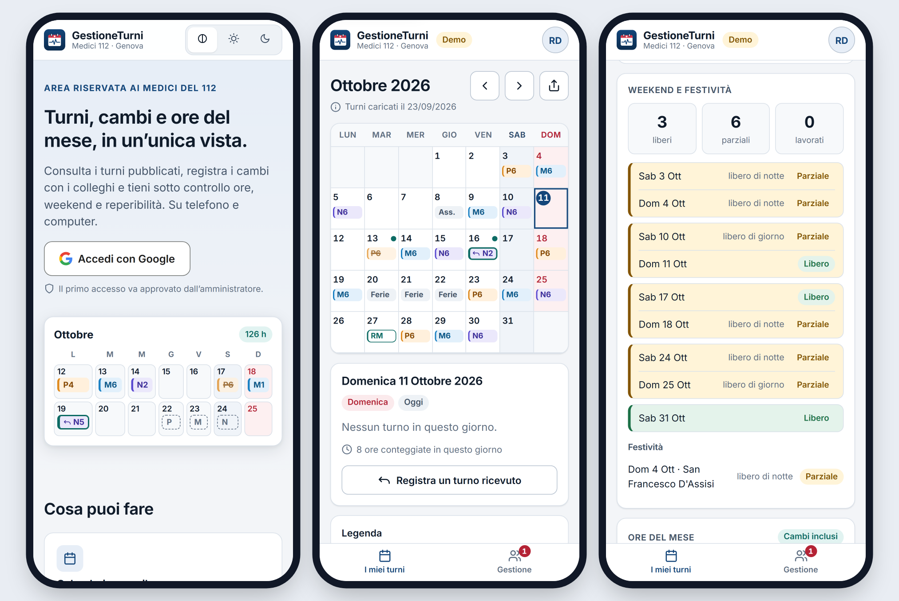
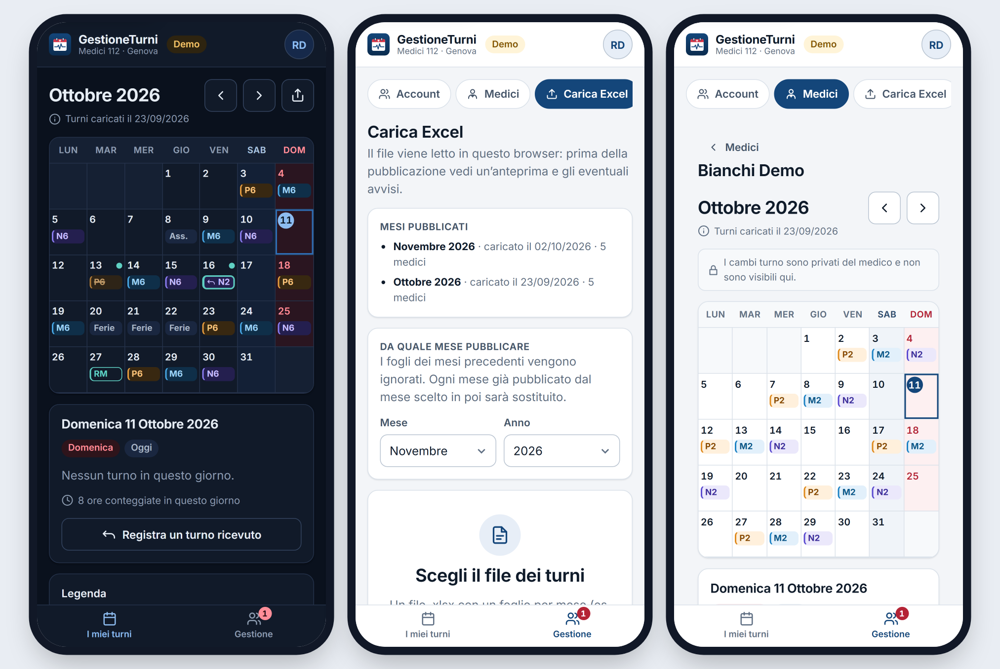
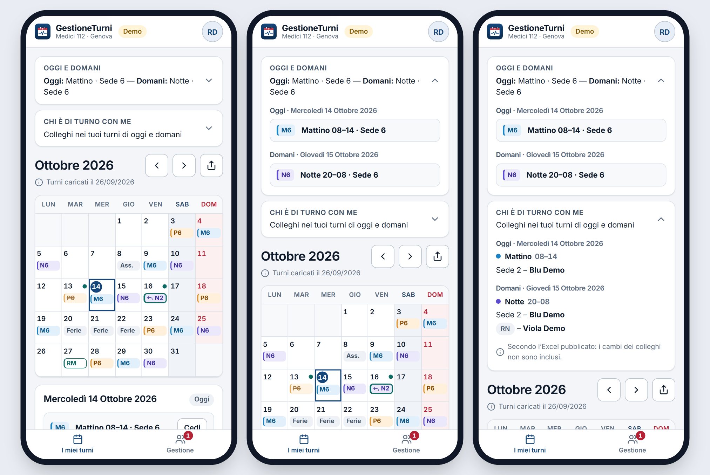
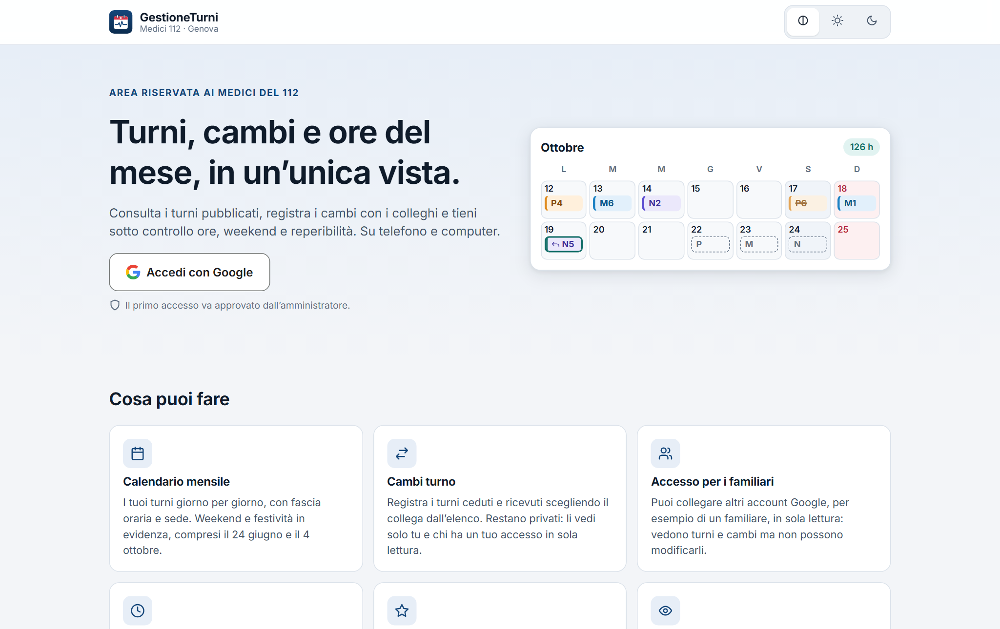
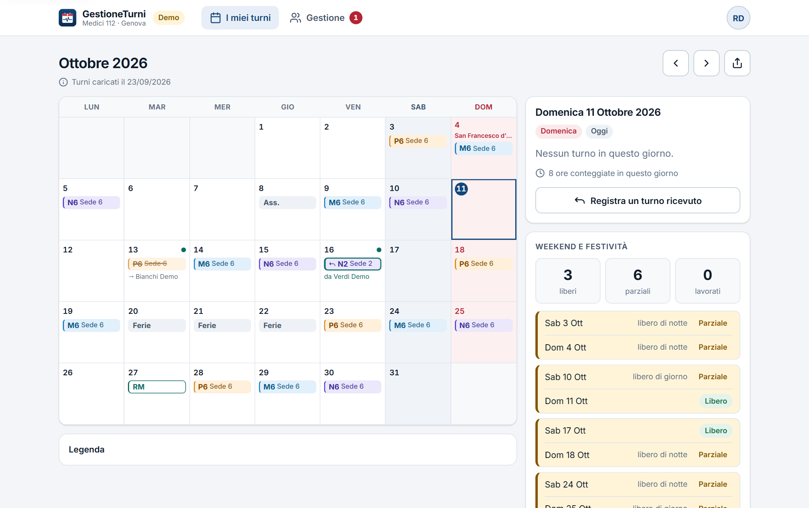
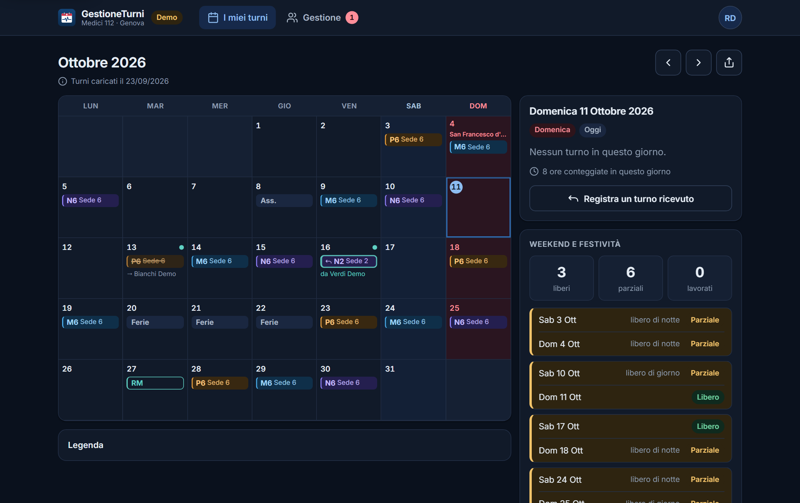
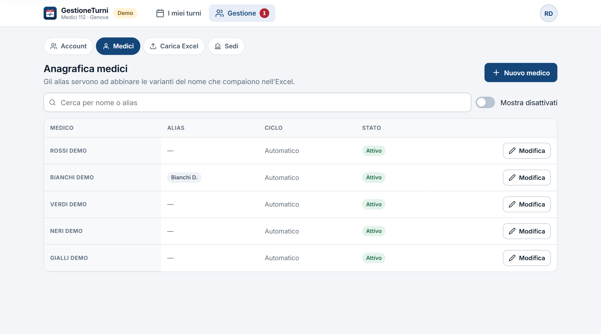

# 118Shifts

**Turni personali per i medici del 112 (ex 118) di Genova, sempre in tasca.**

118Shifts è una Progressive Web App *mobile first* che trasforma il file Excel ufficiale dei turni in un calendario personale chiaro e riservato. Ogni medico vede solo i propri turni, con sedi, festività, ore del mese, cambi e proiezione della turnazione.

> **Stato:** Fase 1 — prima versione pubblicata su Firebase Hosting, in prova. Il repository non contiene dati reali: i turni sono caricati dagli amministratori e restano su Firebase, protetti da regole di accesso.

---

## L'app in breve

> Tutte le immagini usano la **modalità demo** con dati inventati: nessun nome o turno reale.

### Su telefono

*Pagina di accesso · calendario del mese con turni, sedi, cambi e festività · weekend raggruppati e colorati (libero, parziale, lavorato).*


*Tema scuro automatico · caricamento dell'Excel con mese di partenza e mesi già pubblicati · calendario di un medico visto dall'amministratore (senza i cambi, che sono privati).*


*In cima all'area medico: card chiuse con il riassunto · «Oggi e domani» aperta · «Chi è di turno con me» sul giorno selezionato nel calendario, con colleghi e reperibili.*

### Su computer


| Calendario (tema chiaro) | Calendario (tema scuro) |
|---|---|
|  |  |


*Area gestione: anagrafica dei medici con stato (Abilitato/Disabilitato), ultimo accesso e alias per abbinare le varianti del nome presenti nell'Excel; un clic sul nome apre il calendario del medico.*

---

## Funzionalità (Fase 1)

### Per i medici
- **Oggi e domani**: card comprimibile in cima con il proprio turno (sede e orario) di oggi e di domani, cambi già applicati.
- **Chi è di turno con me** (solo account principali): i colleghi della stessa fascia nelle altre sedi e i reperibili (RM, RP, RN, RG) del giorno selezionato nel calendario (all'avvio oggi), secondo l'Excel pubblicato. I cambi dei colleghi non sono inclusi; vengono mostrati solo nome e sede, nei soli giorni in cui il medico stesso lavora.
- **Calendario mensile** dei propri turni — Mattino (08–14), Pomeriggio (14–20), Notte (20–08) — con la **sede** di lavoro.
- **Weekend e festività** evidenziati con codice colore: festività nazionali e **San Giovanni Battista** (24 giugno, patrono di Genova).
- **Card weekend liberi**: sabato e domenica raggruppati per weekend e colorati (libero, parziale, lavorato), più lo stato delle festività del mese.
- **Data di caricamento** dei turni di ogni mese, ben distinta dalla previsione.
- **Card ore del mese** calcolate dall'app, cambi compresi. La notte vale 4 ore sul giorno di inizio e 8 sul giorno successivo.
- **Proiezione** della turnazione sui 12 mesi successivi (ciclo Mattino+Pomeriggio → Notte → smonto → riposo → riposo), distinta graficamente dai turni ufficiali.
- **Cambi turno privati**: il turno ceduto resta visibile barrato con il nome del collega; il turno ricevuto è collegato al cambio e riporta chi l'ha ceduto. Visibili solo agli account del medico.
- **Chi può darti il cambio** (solo account principali): quando si cede un turno, l'app suggerisce i colleghi con almeno 11 ore di riposo prima dell'inizio e dopo la fine (le reperibilità contano come impegno), secondo l'Excel pubblicato; un tocco sul nome lo seleziona. Resta sempre possibile scegliere qualunque collega dall'elenco.
- **Più account per medico**: un account principale (che registra i cambi) e account secondari in sola lettura, per esempio per un familiare.
- **Condivisione del mese come immagine**: un tocco sull'icona di condivisione crea un'immagine del calendario (titolo del mese e griglia, con i cambi già applicati) da inviare come una foto, per esempio su WhatsApp. Nessun link, nessun nome di colleghi.
- **Feedback e suggerimenti**: conversazioni riservate con l'amministratore, una per argomento (segnalazioni o proposte di nuove funzionalità), con badge dei messaggi non letti. Ciascuna parte può chiudere e cancellare la conversazione. Aperte anche agli account secondari.
- **Tema chiaro e scuro**, automatico o a scelta.
- **Installabile** sulla schermata Home di iPhone e Android.

### Per amministratore e delegati
- **Approvazione degli accessi**: al primo login l'utente resta in attesa finché non viene associato a un medico; nell'attesa può presentarsi con un breve messaggio (es. «Sono il dr Rossi»), mostrato nella finestra di associazione.
- **Feedback** (solo amministratore): elenco delle conversazioni dei medici con le non lette in evidenza, risposta, chiusura e cancellazione. I delegati non vi accedono.
- **Gestione account**: associazione account–medico, account principale e secondari, disabilitazione, con **ultimo accesso** di ogni account e del medico (registrato all'apertura dell'app, al massimo una volta al giorno).
- **Importazione dell'Excel** dei turni con anteprima e segnalazione dei codici non riconosciuti prima della pubblicazione. Si sceglie un **mese di partenza** (di default il successivo): i fogli precedenti sono ignorati e ogni mese importato **sostituisce completamente** quello già pubblicato (utile per le correzioni).
- **Mesi pubblicati**: elenco dei mesi caricati con data e numero di medici.
- **Calendario di ogni medico** in sola lettura (senza i cambi, che restano privati).
- **Delegati** nominati dall'amministratore. L'amministratore non è un medico e vede solo l'area di gestione.

## Sicurezza e privacy
- Accesso **solo con account Google** (Firebase Authentication).
- I permessi sono applicati lato server dalle **regole Firestore**, verificate da test automatici.
- Ogni medico legge solo i propri dati; i cambi sono visibili solo ai suoi account.
- I turni dei colleghi (card «Chi è di turno con me») sono visibili solo agli account principali dei medici, mai ai familiari (account secondari).
- Le conversazioni di feedback sono leggibili solo dal loro autore e dall'amministratore (delegati esclusi), come garantito dalle regole.
- Il file Excel è elaborato **nel browser** di chi lo carica: non transita da server terzi.
- Nessun dato personale, credenziale o file di turni è presente nel repository.

## Architettura

```
┌──────────────────────────┐        ┌───────────────────────────────┐
│  PWA (React + TypeScript) │  ◄──►  │  Firebase                     │
│  - calendario e card      │        │  - Authentication (Google)    │
│  - import Excel (SheetJS) │        │  - Firestore + regole         │
│  - logica in src/domain/  │        │  - Hosting                    │
└──────────────────────────┘        └───────────────────────────────┘
```

| Area | Tecnologia |
|---|---|
| Frontend | Vite, React, TypeScript |
| Logica turni | TypeScript puro con test Vitest (`app/src/domain/`) |
| Lettura Excel | SheetJS, nel browser |
| Backend | Firebase Authentication, Cloud Firestore, Hosting (piano gratuito) |
| Test regole | Firebase Emulator Suite + `@firebase/rules-unit-testing` |

## Struttura del repository

```
app/                 PWA
  src/domain/        logica pura: codici turno, parser Excel, ore, festività, proiezione
firebase/            regole e indici Firestore, test delle regole
docs/
  REQUISITI.md       requisiti, formato dell'Excel, legenda codici
  MODELLO-DATI.md    raccolte Firestore e permessi
  DECISIONI.md       registro delle decisioni
  STATO.md           stato del progetto e prossimi passi
firebase.json        configurazione Firebase
```

## Sviluppo

**Requisiti:** Node.js 20+, Firebase CLI, Java 21 (solo per i test delle regole).

```bash
# PWA
cd app
npm install
cp ../.env.example .env   # inserire la configurazione web di Firebase
npm run dev               # http://localhost:5173 — /demo mostra l'app con dati inventati (solo sviluppo)
npm test

# Regole Firestore (emulatore locale, progetto demo: non tocca i dati reali)
cd firebase
npm install
npm run test:rules
```

### Dashboard dei test (live)
Entrambe le suite hanno una dashboard Vitest UI che rilancia i test a ogni modifica del codice:

```bash
npm --prefix app run test:ui                # logica turni   → http://localhost:51204/__vitest__/
npm --prefix firebase run test:rules:ui     # regole Firestore → http://localhost:51205/__vitest__/
```
Il link completo (con token di accesso locale) viene stampato nel terminale.

### Deploy
- **Hosting (automatico):** a ogni push su `main` la GitHub Action [`firebase-hosting-merge.yml`](.github/workflows/firebase-hosting-merge.yml) esegue test e build della PWA e pubblica su Firebase Hosting. La configurazione web e l'account di servizio stanno nei segreti del repository.
- **Regole Firestore (manuale):** dopo i test sull'emulatore, `firebase deploy --only firestore` dalla radice.

## Roadmap
- [x] Analisi del formato Excel e dei requisiti
- [x] Modello dati e regole di sicurezza (102 test sull'emulatore)
- [x] Logica turni: parser, ore, festività, proiezione, disponibilità colleghi (115 test)
- [x] Interfaccia: pagina pubblica, login, calendario, card, cambi
- [x] Pannello amministrazione e import Excel con mese di partenza
- [x] Pubblicazione su Firebase Hosting
- [ ] Prove con i primi medici
- [ ] Fase 2 — da definire

## Licenza
[MIT](LICENSE)
